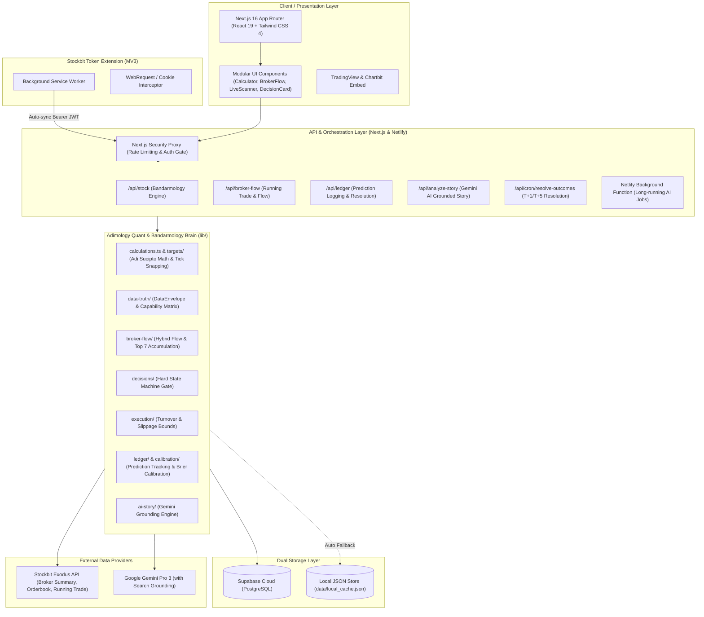

# Dokumentasi Teknis & Arsitektur Lengkap: Adimology (V6 Quant Smart Money)

Dokumentasi ini menyajikan analisis mendalam mengenai arsitektur, struktur kode, fondasi matematis, alur data, integrasi eksternal, dan sistem kecerdasan buatan dalam proyek **Adimology**.

---

## 1. Ringkasan Eksekutif (Executive Summary)

**Adimology** adalah platform intelijen pasar modal Indonesia (IDX/BEI) yang menggabungkan metodologi **Bandarmologi klasik (metode Adi Sucipto)** dengan kerangka kerja **Kuantitatif Modern (Smart Money AI)**. 

### Masalah yang Diselesaikan:
1. **Bias Emosional & Ilusi Likuiditas Retail**: Trader retail kerap terjebak membeli saham saat bandar (smart money) sedang melakukan distribusi terselubung.
2. **Ketiadaan Target Matematis Objektif**: Perhitungan target harga seringkali bersifat tebak-tebakan tanpa memperhitungkan batas tick resmi BEI (*IDX price fractions*), batas volatilitas (ARA/ARB), dan daya serap antrean bid/offer.
3. **Halusinasi Analisis Fundamental/Berita**: Analisis narasi sering terpisah dari realitas angka transaksi bandar.
4. **Ketiadaan Akuntabilitas Prediksi (Prediction Ledger)**: Sebagian besar tools teknikal tidak pernah mengukur akurasi historis (*win rate*, Brier score, calibration curve) dari rekomendasi yang dibuat.

### Solusi Adimology:
- Menghitung **Target Realistis ($R_1$)** dan **Target Maksimal** berbasis rata-rata harga bandar (VWAP Bandar), margin keamanan, dan daya serap volume terhadap total papan.
- **Sistem Kuantitatif 12-Fase (Phase 1–12)** yang mencakup verifikasi kebenaran data (*Data Truth*), gerbang keputusan tegas (*Decision Gate*), gerbang likuiditas (*Liquidity Gate*), pelacakan arus broker hibrida (*Hybrid Broker Flow*), hingga pembukuan prediksi otomatis (*Prediction Ledger & Auto-Resolution*).
- **AI Story Generator Ter-Grounding**: Memanfaatkan Google Gemini Pro dengan *Google Search Grounding* untuk menganalisis katalis, berita, dan SWOT yang terikat ketat pada angka kuantitatif (tanpa halusinasi target).
- **Dual-Storage Architecture**: Berjalan mulus di cloud via **Supabase PostgreSQL** atau 100% offline/lokal via file-based **Local Cache JSON Fallback**.

---

## 2. Arsitektur Sistem (High-Level Architecture)



---

## 3. Struktur Direktori & Analisis Modul

Struktur direktori proyek dirancang terisolasi per domain (Clean Architecture / Domain-Driven Design):

```
adimology/
├── app/                              # Next.js 16 App Router Layer
│   ├── api/                          # REST API Endpoints (Route Handlers)
│   │   ├── analyze-custom-signal/    # Evaluasi sinyal kustom pengguna
│   │   ├── analyze-story/            # Pemicu analisis AI Story Gemini
│   │   ├── analyze-watchlist/        # Analisis batch untuk seluruh watchlist
│   │   ├── auth/                     # Autentikasi aplikasi (Password Gate)
│   │   ├── broker-flow/              # Agregasi data aliran broker harian
│   │   ├── calibration/              # Endpoint kurva kalibrasi probabilitas
│   │   ├── cron/resolve-outcomes/    # Endpoint pemicu resolusi hasil prediksi
│   │   ├── emiten/flag/              # Manajemen flag emiten (Watchlist/Favorit)
│   │   ├── job-logs/ & job-retry/    # Pemantauan & pengulangan background jobs
│   │   ├── keystats/                 # Data fundamental rasio finansial
│   │   ├── ledger/                   # Akses buku besar prediksi (Prediction Ledger)
│   │   ├── profile/ & sectors/       # Preferensi profil & daftar sektor IDX
│   │   ├── stock/                    # Endpoint inti kalkulator bandarmologi
│   │   ├── token-status/             # Diagnostik masa berlaku token Stockbit
│   │   ├── update-token/             # Sinkronisasi token dari Chrome Extension
│   │   └── watchlist/                # Sinkronisasi & manajemen watchlist Stockbit
│   ├── backtest/                     # Halaman laboratorium backtest strategi
│   ├── data-health/                  # Dashboard pemantauan integritas data
│   ├── history/                      # Halaman arsip riwayat analisis emiten
│   ├── journal/                      # Jurnal trading & post-mortem analitik
│   ├── model-health/                 # Dashboard performa model, Brier score, ECE
│   ├── scanner/                      # Real-time scanner pasar saham
│   ├── signals/                      # Laboratorium pembuatan custom signal
│   ├── summary/                      # Dashboard performa & hit rate bandar
│   ├── components/                   # 30+ Komponen UI Reaktif (React 19)
│   ├── globals.css                   # Tailwind CSS 4 & styling tema gelap/terang
│   └── page.tsx                      # Dashboard utama Adimology
├── data/
│   └── local_cache.json              # Database lokal (Fallback saat Supabase offline)
├── docs/                             # Panduan instalasi, deployment, & checkpoint
├── lib/                              # Core Computational Brain (Mesin Kuantitatif)
│   ├── accumulation/                 # Deteksi proxy akumulasi/distribusi
│   ├── ai-story/                     # Grounding engine prompt & Gemini client
│   ├── broker-flow/                  # Engine hybrid running-trade & broker summary
│   ├── calibration/                  # Platt scaling, isotonic regression, & Brier score
│   ├── config/                       # Konfigurasi fraksi tick IDX resmi
│   ├── data-truth/                   # DataEnvelope & Capability Matrix
│   ├── decisions/                    # Hard Decision Gate State Machine
│   ├── execution/                    # Liquidity Gate & Entry Risk Engine
│   ├── indicators/                   # Engine teknikal: RSI, BOS, Order Blocks, Liquidity Sweeps
│   ├── journal/                      # Post-mortem engine & signal journaling
│   ├── ledger/                       # Prediction ledger & automated outcome resolution
│   ├── market-context/               # Deteksi rezim pasar (Bull, Bear, Volatile)
│   ├── models/                       # Accumulation state model & trade outcome model
│   ├── targets/                      # Multi-target ladder & invalidation engine
│   ├── brokers.ts                    # Direktori klasifikasi broker IDX (Whale/Retail/Mix)
│   ├── calculations.ts               # Implementasi rumus asli Adi Sucipto
│   ├── local-store.ts                # Adapter manipulasi disk JSON lokal
│   ├── pdfExport.ts                  # Multi-page PDF report generator
│   ├── stockbit.ts                   # Client API Stockbit Exodus & sesi token
│   ├── supabase.ts                   # Client database Supabase dengan auto fallback
│   └── types.ts                      # Definisi TypeScript global
├── netlify/                          # Netlify Serverless Functions
│   └── functions/                    # analyze-watchlist-background.ts (Job antre)
├── stockbit-token-extension/         # Ekstensi Chrome Manifest V3 untuk sync sesi
├── supabase/                         # 21 Skrip migrasi SQL PostgreSQL
└── tests/                            # 18 Test Suites (Validasi Phase 1 s/d Phase 12)
```

---

## 4. Fondasi Matematis & Algoritma

### 4.1 Rumus Asli Adi Sucipto (Bandarmologi Baseline)
Perhitungan klasik diimplementasikan dalam [`lib/calculations.ts`](file:///d:/agent%202/adimology/lib/calculations.ts):

1. **Fraksi Harga BEI ($Fraksi$)**:
   Diselaraskan dengan aturan fraksi harga resmi Bursa Efek Indonesia:
   $$\text{Fraksi}(P) = \begin{cases} 
   1 & \text{jika } P < 200 \\
   2 & \text{jika } 200 \le P < 500 \\
   5 & \text{jika } 500 \le P < 2000 \\
   10 & \text{jika } 2000 \le P < 5000 \\
   25 & \text{jika } P \ge 5000 
   \end{cases}$$

2. **Total Papan ($TotalPapan$)**:
   Rentang pergerakan harga dari batas Auto Rejection Bawah (ARB) hingga Auto Rejection Atas (ARA) dalam satuan tick/fraksi:
   $$TotalPapan = \max\left(1, \frac{ARA - ARB}{Fraksi}\right)$$

3. **Rata-rata Kedalaman Bid-Offer ($RataRataBidOffer$)**:
   Rata-rata lot antrean per papan harga:
   $$RataRataBidOffer = \max\left(1, \frac{TotalBid + TotalOffer}{TotalPapan}\right)$$

4. **Margin Minimum Bandar ($a$)**:
   Ekspektasi keuntungan minimum yang ditargetkan oleh bandar (diasumsikan 5% dari modal rata-rata):
   $$a = RataRataBandar \times 0.05$$

5. **Daya Serap Lot Bandar ($p$)**:
   Berapa papan harga yang dapat ditembus atau diserap oleh barang milik bandar:
   $$p = \frac{BarangBandar}{RataRataBidOffer}$$

6. **Target Harga**:
   - **Target Realistis ($R_1$)**:
     $$Target_{realistis} = \text{SnapToTick}\left(RataRataBandar + a + \left(\frac{p}{2} \times Fraksi\right)\right)$$
   - **Target Maksimal ($Target_{max}$)**:
     $$Target_{max} = \text{SnapToTick}(RataRataBandar + a + (p \times Fraksi))$$

---

### 4.2 Evolusi V6: Kerangka Quant Smart Money 12-Fase

Adimology V6 memperluas rumus di atas menjadi sistem kuantitatif penuh:

```
┌─────────────────┐     ┌──────────────────┐     ┌──────────────────┐
│  Phase 1:       │ ──> │  Phase 5:        │ ──> │  Phase 6:        │
│  Data Truth     │     │  Hybrid Flow     │     │  Dynamic Targets │
└─────────────────┘     └──────────────────┘     └──────────────────┘
         │                                                 │
         ▼                                                 ▼
┌─────────────────┐     ┌──────────────────┐     ┌──────────────────┐
│  Phase 7:       │ ──> │  Decision Gate   │ ──> │  Phase 2:        │
│  Liquidity Gate │     │  (State Machine) │     │  Prediction      │
└─────────────────┘     └──────────────────┘     │  Ledger Log      │
                                                 └──────────────────┘
                                                           │
                                                           ▼
┌─────────────────┐     ┌──────────────────┐     ┌──────────────────┐
│  Phase 3 & 4:   │ <── │  Phase 9:        │ <── │  Phase 11:       │
│  Calibration &  │     │  Baseline        │     │  Auto-Resolution │
│  Brier Metrics  │     │  Benchmark       │     │  (T+1 / T+5)     │
└─────────────────┘     └──────────────────┘     └──────────────────┘
```

1. **Phase 1: Data Truth Envelope (`lib/data-truth/`)**:
   Setiap data dibungkus dalam `DataEnvelope<T>` dengan status ketertelusuran:
   - `CONFIRMED`: Data transaksi riil EOD terverifikasi.
   - `DELAYED`: Data intraday dengan jeda waktu bursa.
   - `ESTIMATED`: Data turunan kalkulasi heuristik.
   - `UNAVAILABLE`: Data gagal diakses/kadaluwarsa (otomatis memicu *fail-safe*).

2. **Phase 5: Hybrid Broker Flow (`lib/broker-flow/`)**:
   Menggabungkan *Top 7 Broker Active Running Trade* dengan *EOD Broker Summary*. Mengklasifikasikan broker menjadi:
   - **Whale**: Broker institusi besar / asing (e.g., ZP, RX, BK, AK, CS).
   - **Retail**: Broker dengan dominasi investor ritel (e.g., YP, PD, XC, NI, XL).
   - **Mix**: Broker campuran (e.g., CC, OD, LG).
   Mengukur *Absorption Ratio* dan *Multi-Day Consistency Index*.

3. **Phase 6: Multi-Target Ladder & Volatility Invalidation (`lib/targets/`)**:
   - $T_1$ (Realistic Target)
   - $T_2$ (Stretch Target)
   - $T_{max}$ (Structural Ceiling)
   - **Invalidation Barrier (Stop Loss)**: Dijangkarkan pada volatilitas ATR atau struktur swing low terdekat, bukan persentase acak.
   - **Risk-Reward Ratio (RRR)**: Wajib $\ge 1.5\text{x}$. Jika $< 1.5\text{x}$, sinyal masuk kategori `GATED`.

4. **Phase 7: Liquidity Gate (`lib/execution/liquidity-gate.ts`)**:
   Menolak saham yang tidak likuid untuk melindungi modal pengguna:
   - Minimum Rata-rata Nilai Transaksi Harian: $\ge \text{Rp 1.000.000.000}$.
   - Maksimum Spread Bid/Offer: $\le 1.5\%$.
   - Estimasi Slippage: Berdasarkan kedalaman 3 papan teratas.

5. **Decision Gate State Machine (`lib/decisions/decision-gate.ts`)**:
   Menghasilkan keputusan final tanpa kompromi:
   - `ENTER_NOW`: Seluruh gerbang kuantitatif, likuiditas, dan flow terpenuhi.
   - `BUY_CONDITIONAL`: Menunggu level breakout / konfirmasi volume.
   - `WAIT_PULLBACK`: Menunggu harga mendekati level VWAP Bandar.
   - `WATCH`: Akumulasi terdeteksi tetapi likuiditas atau RRR belum optimal.
   - `NO_TRADE`: Data tidak lengkap, pasar distribusi, atau spread terlalu lebar.

6. **Phase 2 & 11: Prediction Ledger & Auto-Resolution (`lib/ledger/`)**:
   - Setiap sinyal yang dianalisis dicatat dengan snapshot harga, target, dan tanggal kadaluwarsa ($T+1$ s/d $T+5$).
   - Cron job harian (`/api/cron/resolve-outcomes`) mengambil harga tertinggi (*High*) dan terendah (*Low*) aktual untuk menentukan status akhir: `HIT_TARGET`, `STOPPED_OUT`, atau `EXPIRED`.

7. **Phase 3 & 4: Probability Calibration & Brier Score (`lib/calibration/`)**:
   - Menghitung akurasi probabilitas model menggunakan **Brier Score**:
     $$BS = \frac{1}{N} \sum_{t=1}^N (f_t - o_t)^2$$
     *(di mana $f_t$ adalah probabilitas prediksi dan $o_t \in \{0, 1\}$ adalah hasil riil).*
   - Kurva kalibrasi membagi prediksi ke dalam 10 desil (Decile 1–10) untuk memastikan probabilitas 70% benar-benar menghasilkan kemenangan 70% di lapangan.

---

## 5. Integrasi Eksternal

### 5.1 Stockbit Exodus API & Token Vaulting
- Data transaksi IDX diperoleh dari endpoint internal Stockbit:
  - `/marketdetectors/{emiten}`: Broker summary, volume net, buyer/seller list.
  - `/orderbook/{emiten}`: Antrean bid/offer real-time.
  - `/running-trade-chart`: Aliran transaksi top 7 broker aktif.
  - `/watchlist`: Sinkronisasi daftar pantau pengguna.
- **Mekanisme Token**:
  - Dikirim melalui header `Authorization: Bearer <JWT>`.
  - Dilengkapi sistem sanitasi otomatis di [`lib/stockbit.ts`](file:///d:/agent%202/adimology/lib/stockbit.ts) dan [`lib/supabase.ts`](file:///d:/agent%202/adimology/lib/supabase.ts) untuk mencegah error awalan ganda `Bearer Bearer ...`.
  - Ekstensi Chrome (`stockbit-token-extension`) mencegat JWT dari cookies/local storage Stockbit dan mengirimkannya ke endpoint `/api/update-token`.

### 5.2 Google Gemini AI dengan Search Grounding
- **Paket**: `@google/genai` (SDK Resmi V1).
- **Prompt Grounding Protocol (`lib/ai-story/grounding-engine.ts`)**:
  - Prompt ke Gemini disuntikkan amplop data kuantitatif (*Verified Quantitative Envelope*): harga saat ini, $T_1$, $T_{max}$, stop loss, RRR, klasifikasi broker, dan likuiditas.
  - Model dilarang keras mengubah angka target atau mengarang data finansial.
  - Google Search Grounding diaktifkan untuk mengambil berita bursa dan keterbukaan informasi terkini.
  - **Sistem Anti-Stuck**: Jika pemrosesan AI terhambat, polling di frontend otomatis dibatasi maksimal 3 menit dan menyediakan opsi *Retry* manual.

---

## 6. Arsitektur Data: Skema Database & Dual-Storage Fallback

Sistem menerapkan prinsip **Zero Cloud Dependency Fallback**: jika URL Supabase tidak dikonfigurasi atau gagal terkoneksi, semua operasi baca/tulis secara otomatis dialihkan ke file lokal [`data/local_cache.json`](file:///d:/agent%202/adimology/data/local_cache.json) melalui [`lib/local-store.ts`](file:///d:/agent%202/adimology/lib/local-store.ts).

### Tabel Utama (PostgreSQL / Local Cache):

| Nama Tabel / Entitas | Deskripsi & Fungsi |
|---|---|
| `session` | Menyimpan token JWT Stockbit, status validitas, dan waktu kedaluwarsa |
| `stock_queries` | Riwayat perhitungan kalkulator emiten ($ARA$, $ARB$, $R1$, $Max$, $Papan$) |
| `agent_story` | Hasil analisis narasi AI Gemini (Summary, SWOT, Catalysts, Multi-version) |
| `background_job_logs` | Catatan eksekusi background jobs Netlify untuk analisis batch |
| `emiten_flags` | Penanda kustom emiten (e.g., "OK", "WATCH", "AVOID") |
| `profile_settings` | Preferensi antarmuka pengguna (jumlah baris tabel, tema, dll.) |
| `watchlist_cache` & `items` | Cache daftar pantau saham pengguna dari akun Stockbit |
| `prediction_ledger` | Rekam jejak seluruh sinyal kuantitatif untuk audit performa |
| `calibration_snapshots` | Snapshot berkala metrik Brier Score, ECE, dan kalibrasi desil |

---

## 7. Keamanan & Proteksi Sistem

1. **Proxy Keamanan (`proxy.ts`)**: Melindungi API dari akses publik yang tidak diizinkan dan membatasi ukuran request.
2. **Password Gate (`PasswordGate.tsx`)**: Akses antarmuka dapat dikunci dengan kata sandi pribadi untuk mencegah penyalahgunaan sesi Stockbit yang tersinkronisasi.
3. **Penyimpanan Token Terisolasi**: Sesi Stockbit disimpan pada database privat dan tidak pernah diekspos ke klien tanpa otentikasi.
4. **Pembatasan Transaksi**: Aplikasi ini murni berupa sistem analitik pembacaan (*read-only*) data transaksi bursa; tidak memiliki akses ke PIN transaksi Stockbit sehingga tidak dapat mengeksekusi order riil di sekuritas.

---

## 8. Panduan Verifikasi & Rangkaian Pengujian (Test Suites)

Proyek dilengkapi dengan 18 berkas pengujian otomatis di direktori [`tests/`](file:///d:/agent%202/adimology/tests):

- `phase1-data-truth.test.ts`: Verifikasi integritas dan status amplop data.
- `phase2-prediction-ledger.test.ts`: Verifikasi pencatatan sinyal ke buku besar.
- `phase3-probability-calibration.test.ts`: Verifikasi rumus kalibrasi Brier & desil.
- `phase4-decile-metrics.test.ts`: Validasi pengelompokan performa desil.
- `phase5-hybrid-flow.test.ts`: Validasi perhitungan akumulasi broker gabungan.
- `phase6-dynamic-targets.test.ts`: Validasi snapping fraksi tick resmi IDX.
- `phase7-liquidity-gate.test.ts`: Validasi penolakan saham tidak likuid.
- `phase8-horizon-gating.test.ts`: Validasi kepatuhan time-horizon analisis.
- `phase9-baseline-benchmark.test.ts`: Perbandingan target klasik vs dynamic ladder.
- `phase10-ai-story-grounding.test.ts`: Uji isolasi konteks prompt Gemini AI.
- `phase11-auto-resolution.test.ts`: Uji verifikasi kenaikan harga riil ($T+1$/$T+5$).
- `phase12-pdf-export.test.ts`: Validasi integritas data pada dokumen laporan PDF.
- `quant-smartmoney-ai.test.ts`: End-to-end integration test seluruh modul kuantitatif.

---

## 9. Kesimpulan & Rekomendasi Pengembangan Lanjutan

Proyek **Adimology** telah berevolusi dari sekadar kalkulator target sederhana berbasis spreadsheet menjadi sistem intelijen kuantitatif berbasis web yang matang dan berstandar institusional.

### Rekomendasi Pengembangan Mendatang:
1. **Model Machine Learning Lokal (ONNX/LightGBM)**: Menjalankan model klasifikasi probabilitas secara langsung di browser tanpa dependensi cloud.
2. **Realtime Webhook Alert**: Integrasi notifikasi Telegram/Discord saat emiten pada watchlist menyentuh area akumulasi *Whale* atau menembus gerbang keputusan `ENTER_NOW`.
3. **Multi-Broker Depth Analysis**: Analisis struktur order book level 2 & level 3 untuk mendeteksi order fiktif (*fake bid/offer*).
